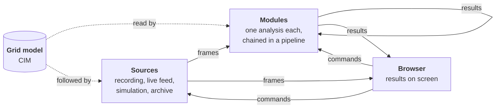

# How p-SWAMP works

p-SWAMP takes measurements in at one end, runs analyses on them, and shows the
results in a browser. This page follows the measurements through it.

## Sources: where measurements come from

A **source** produces measurements, one snapshot at a time. A snapshot (a
*frame*) holds what every PMU measured at one instant. A source can be:

- **a recording**, replayed at its own pace, which you can pause, rewind and
  speed up;
- **a live feed**, which can only be followed as it arrives;
- **a simulation** of the grid, running in real time;
- **an archive** kept by the organisation running p-SWAMP, read through a small
  web service (p-SWAMP itself stores nothing).

## Modules: what is done with them

A **module** is one analysis. It declares what it reads and what it publishes,
and turns each input into a result: an average, an alarm, a detected island.
Modules connect into a **pipeline**: one module's results are the next
module's input. A pipeline is described in a short file listing its sources and
modules, so adding an analysis means adding a module and a line to that file,
not changing p-SWAMP.

A module does not know where it runs. The same module runs inside the web
server, in a separate process beside it (to spread the work over a machine's
cores), or in a plain script on a laptop, with no change to its code.

## The grid model

Analyses often need to know the grid itself: which stations exist, which lines
join them, which breaker is open. p-SWAMP keeps one **grid model** for every
module to read, in **CIM**, the standard format grid operators use to exchange
models (its European profile is called **CGMES**). Each measurement in a frame
points to what it measures in that model, so an analysis can tell which line a
current was measured on.

The live simulation follows the model: open a breaker, and the simulation opens
it too; what the simulation's protection does is written back to the model.

## The browser: results and commands

The web application shows the results as they are produced. Anything you do
there (pause a replay, open a breaker, acknowledge an alarm) is sent to the
server as a command, and the result comes back on the screen like any other
change, so everyone looking at the same thing sees the same result.

## For developers

This page is the short version. The full account is
[the server data architecture](../server-data-architecture.md), and the recipe
for a new module is [the module cookbook](../module-cookbook.md).
