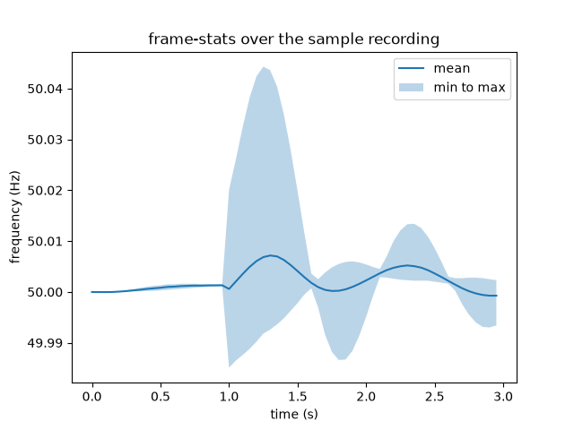

# From a script

Every analysis in p-SWAMP is a module, and a module is plain Python. It runs
from a script on your own computer, with no server, no containers and no
browser. This is how you try an idea quickly, or use p-SWAMP's analyses in a
notebook.

You need only [uv](what-you-need.md#2-uv-to-run-the-python-parts) for this page.

## Replay a recording through an analysis

p-SWAMP ships with a short recording: three seconds of five stations in the
Nordic 44 test grid, 20 snapshots per second, during a line trip. This replays
it through the [frame-stats](../modules/frame-stats/index.md) module, which
computes the average, lowest and highest frequency of each snapshot:

```python
from pswamp_modules.frame_stats import FrameStatsModule
from pswamp_modules.sample_replay import SampleReplay

stats = FrameStatsModule()
for frame in SampleReplay().read():
    result = stats.run_one(frame).result
    print(frame.timestamp, result.mean_frequency_hz)
```

Two pieces, each a module: `SampleReplay` is a [source](../modules/sample-replay/index.md),
which produces the snapshots, and `FrameStatsModule` an analysis, which reads
each one and returns its result.

## Plot it

The same thing, as a chart, is one of the examples that come with p-SWAMP:

```shell
uv run --package pswamp-sample-replay --extra examples python modules/sample-replay/examples/replay_stats.py
```

A window opens with the frequency over the three seconds. Add
`--save stats.png` to write the chart to a file instead:

<figure markdown>

<figcaption markdown>The line trip, at one second, is where the stations'
frequencies spread apart: the shaded band runs from the lowest to the highest.
Simulated data from the Nordic 44 test grid; see
[data licensing](../project/data-licensing.md).</figcaption>
</figure>

## Every module has examples

Each module's folder has an `examples/` folder of scripts like this one, listed
on its page under [Modules](../modules/index.md). The
[module cookbook](../module-cookbook.md) shows how to write a module of your own,
starting from a generated one.
