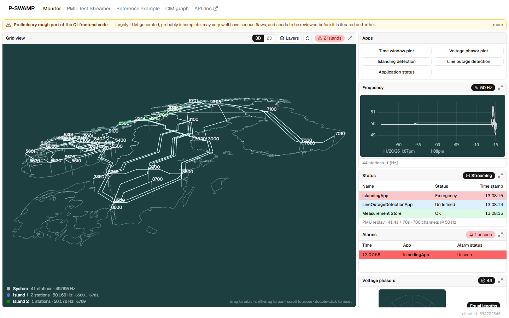
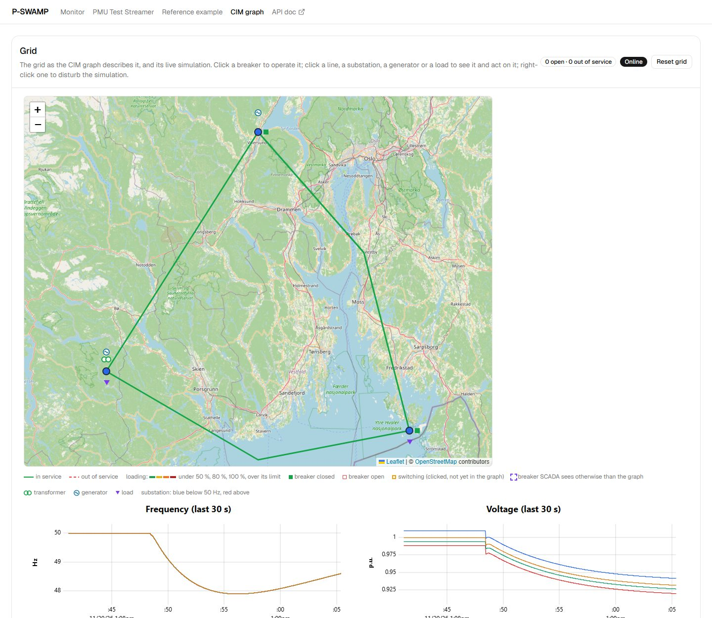

# A tour

With p-SWAMP [running](first-run.md), the bar at the top of the page leads to
each part of it. This page shows what each one is, and what to try.

Everything you do is private to your browser and undone by a restart: each
browser gets its own replay, starting from the beginning, and nothing is saved.
The one exception is the grid on the **CIM graph** page, which everyone
connected to the same server shares.

## The monitor

<figure markdown>

<figcaption markdown>The monitor about 40 seconds into the replay, just after
the line trip: two small islands have separated from the rest of the grid.
Simulated data from the Nordic 44 test grid; see
[data licensing](../project/data-licensing.md).</figcaption>
</figure>

The **Monitor** is the main window. It replays a 70-second recording of the
Nordic 44 test grid, measured by PMUs at all 44 of its stations, 50 times a
second, through p-SWAMP's monitoring applications, exactly as if it were
happening now.

- **The grid view** in the middle draws the grid over a map of the Nordic
  countries. Each separate part of the grid (an *island*) has its own colour, and
  is raised or lowered by how far its frequency is from 50 Hz. Drag to turn it,
  or switch to **2D**. **Layers** spreads the frequency or the voltage over the
  map as a colour field.
- **Frequency** plots every station's frequency over the last few seconds.
- **Status** shows each monitoring application and what it currently reports.
- **Alarms** lists what the applications raised. Click one to see its details,
  acknowledge it, and add a note.
- **Voltage phasors** draws each station's voltage as an arrow: its length is
  the voltage, its angle the phase. When the grid is stressed, the arrows fan
  out.
- **Line outages** lists the lines whose current dropped to zero, and when they
  came back.

**What to watch for.** About half a minute in, a line trips. Several stations
in the north are cut off from the rest of the grid: the grid view shows them as
separate islands, the islanding application raises an alarm, and the line
outage detector lists the lines that went out. Later the line is reconnected and
the islands rejoin.

Each panel has an expand button (:material-arrow-expand:) that opens it on a
page of its own, full size.

## The CIM graph

<figure markdown>

<figcaption markdown>The CIM graph page showing p-SWAMP's small sample grid,
a few seconds after a load was stepped up: the frequency falls and the voltages
sag. Map data © OpenStreetMap contributors.</figcaption>
</figure>

The **CIM graph** page runs a simulation of a grid in real time, and lets you
operate it. The grid comes from a model in the standard format grid operators
exchange (CIM/CGMES); by default it is the Nordic 44 test grid.

- **Click a breaker** (the small squares) to open or close it.
- **Click a line, a substation, a generator or a load** to see what the model
  says about it, its live values and their last 30 seconds.
- **Right-click** one of them (a long press on a touch screen) to disturb the
  simulation: trip a line, cause a short circuit, or change a load. Protection
  clears a fault the way real protection relays would.
- **The charts** below the map show every station's frequency and voltage over
  the last 30 seconds.
- **Reset grid** puts everything back.

Lines are coloured by how heavily they are loaded. A disturbance never changes
the model itself, only the simulation; what the simulated protection does in
response (open breakers) does change it, as it would in a real control system.

## The PMU test streamer

<figure markdown>

<figcaption>The PMU test streamer, paused at the start of the sample recording.</figcaption>
</figure>

The **PMU Test Streamer** is a workbench for p-SWAMP's building blocks rather
than a monitoring screen. It shows one stream of measurements going through a
chain of [modules](../modules/index.md):

- **The source**: choose between the short sample recording (*sample*), a looping
  imitation of a live feed (*live*), and the live grid simulation (*rtsim*).
- **The player**: play, pause, step, jump to an instant or change the speed of a
  recording. A live source can only be followed.
- **The results** of three analysis modules: [frame statistics](../modules/frame-stats/index.md)
  (average frequency, angle spread), [excursions](../modules/excursion/index.md)
  of the frequency outside a band around 50 Hz (tick *pause on excursion* to stop
  the replay when one happens), and a [summary](../modules/range-summary/index.md)
  of the next second, on request.

Developers use it to check that a change to p-SWAMP's core still works end to
end.

## The reference example

The **Reference example** is a counter, and deliberately nothing more. It is the
smallest complete page of the web application, the one to copy when building a
new one, and the one the automated tests click through to prove the whole
application still works.

## Next

- [Concepts](../concepts/wampac.md): what the measurements are, and how p-SWAMP
  handles them.
- [From a script](from-a-script.md): run the same analyses without the web
  application.
